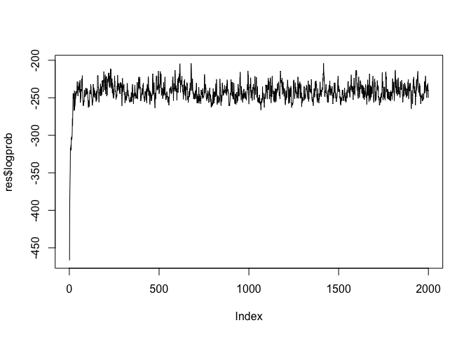
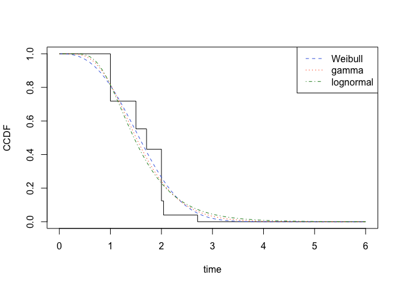

FluA data analysis
================
Ko Abe
2026-10-27

## Setup

We will compare the parametric models provided by `coarseDataTools` with
the non-parametric estimators provided by `JointII`.

``` r
library(coarseDataTools)
library(JointII)
```

We use the data on the incubation period of influenza A provided in
`coarseDataTools`.

``` r
data("fluA.inc.per")
head(fluA.inc.per)
```

    ##   author year EL  ER  SL  SR type
    ## 1  moser 1977  0 0.5 1.0 1.5    0
    ## 2  moser 1977  0 0.5 1.5 2.0    0
    ## 3  moser 1977  0 0.5 1.5 2.0    0
    ## 4  moser 1977  0 0.5 1.5 2.0    0
    ## 5  moser 1977  0 0.5 1.5 2.0    0
    ## 6  moser 1977  0 0.5 1.5 2.0    0

## Run Gibbs sampler

The Gibbs sampler for obtaining a non-parametric estimator can be
executed with the following single line.

``` r
set.seed(20261027)
res <- conditional_dic_gibbs(fluA.inc.per$EL,fluA.inc.per$ER, fluA.inc.per$SL,fluA.inc.per$SR, iter=2000)
```

Plot the log-likelihood and check the convergence of the Markov-chain
Monte-Carlo (MCMC) sequences.

``` r
plot(res$logprob, type = "l")
```

<!-- -->

## Plot

We perform maximum likelihood estimation for the parametric models.

``` r
flu_opt_g <- optim(c(0, 1), loglikhd, dat = fluA.inc.per, dist = "G")

flu_opt_w <- optim(c(0, 1), loglikhd, dat = fluA.inc.per, dist = "W")

flu_opt_l <- optim(c(0, 1), loglikhd, dat = fluA.inc.per, dist = "L")
```

We treat the first 1000 steps as a burn-in period and take the average
of the MCMC samples.

``` r
burnin <- 1:1000
CCDF <- rowMeans(apply(res$incubation[,-burnin],2,prob2ccdf))
```

Plotting a parametric model and a non-parametric estimator together
allows you to assess the goodness of fit.

``` r
plot(res$breaks, CCDF, type = "s", xlab = "time", ylab="CCDF")
c3 <- c("royalblue", "orangered", "forestgreen")
curve(pweibull(x, exp(flu_opt_w$par[1]), exp(flu_opt_w$par[2]), lower.tail = FALSE),
      add=TRUE, col=c3[1], lty=2, ylab="CCDF", xlab="incubation period")
curve(pgamma(x, exp(flu_opt_g$par[1]), scale = exp(flu_opt_g$par[2]), lower.tail = FALSE),
      add=TRUE, col=c3[2], lty=3)
curve(plnorm(x, flu_opt_l$par[1], sdlog = exp(flu_opt_l$par[2]), lower.tail = FALSE),
      add=TRUE, col=c3[3], lty=4)
legend("topright",  legend = c("Weibull", "gamma", "lognormal"), lty=2:4, col=c3, lwd=1)
```

<!-- -->
